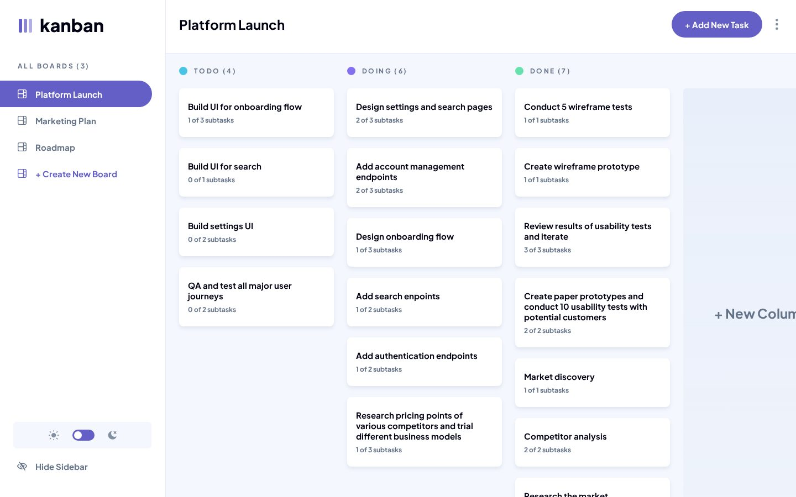
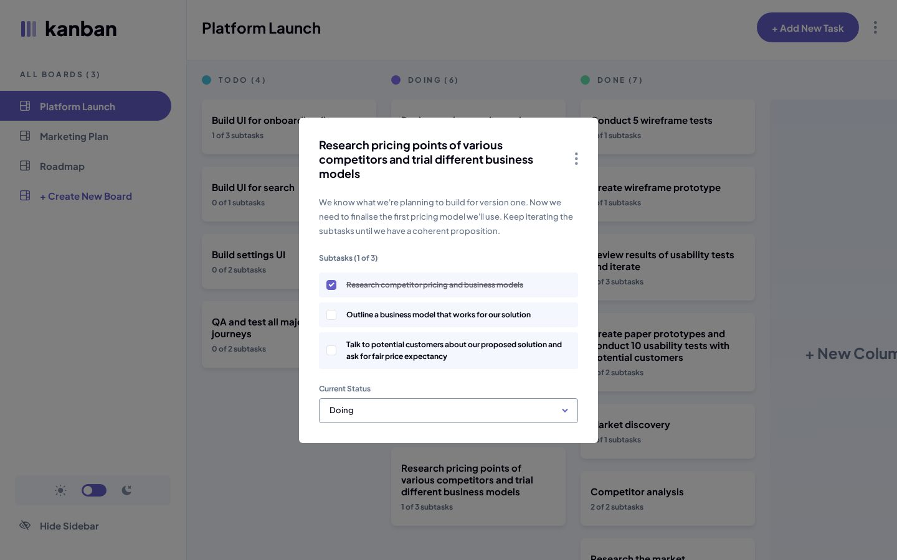
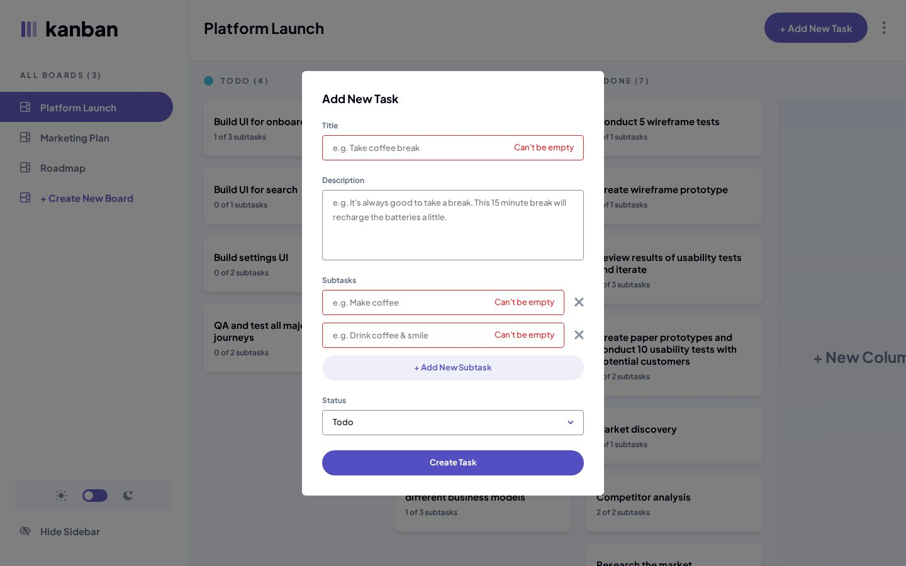
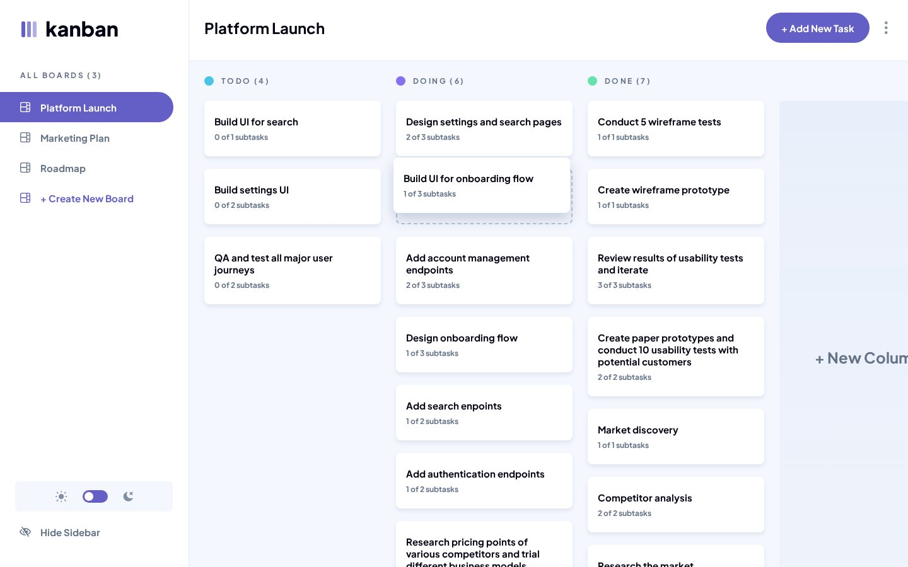
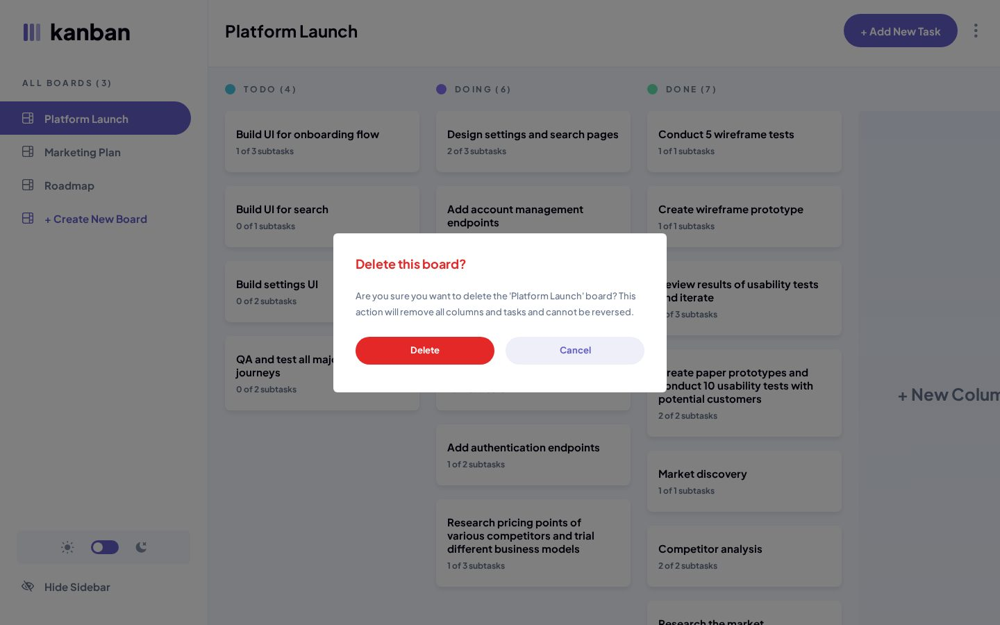
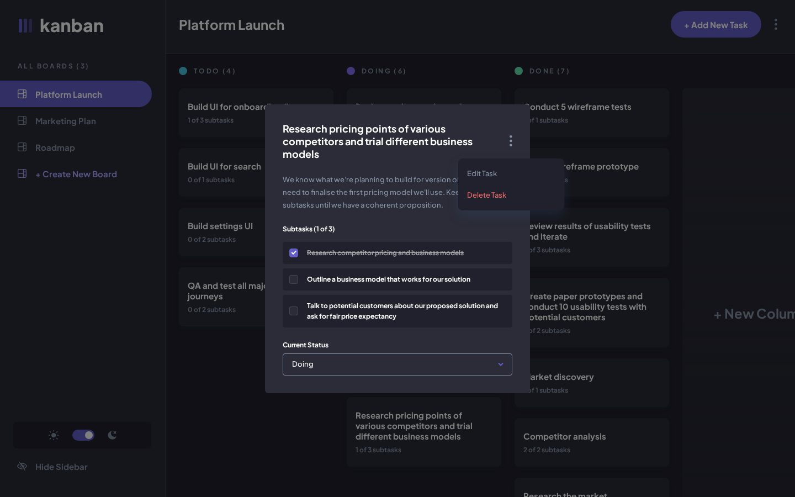
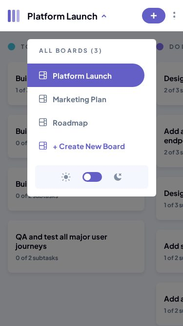
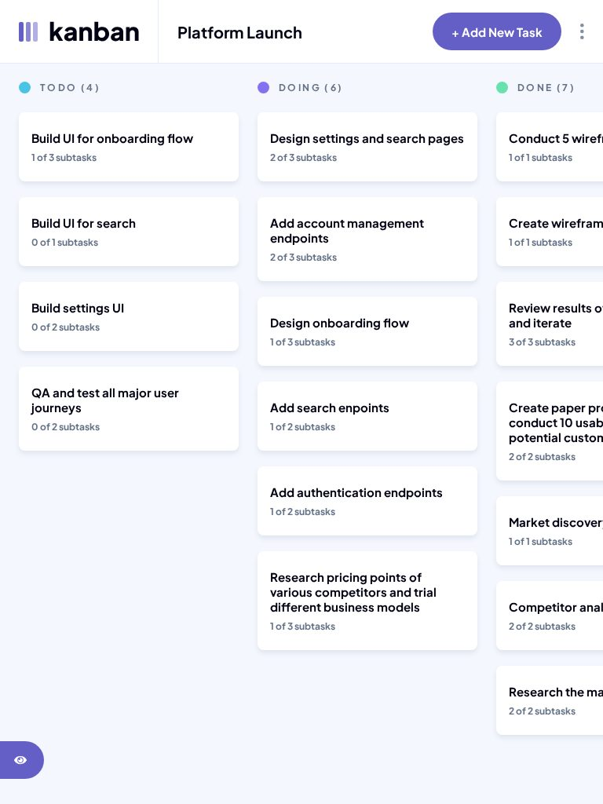
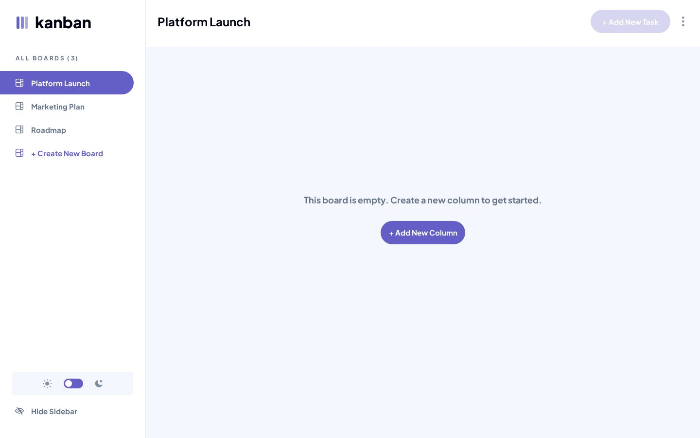

# Frontend Mentor - Kanban task management web app solution

This is a solution to the [Kanban task management web app challenge on Frontend Mentor](https://www.frontendmentor.io/challenges/kanban-task-management-web-app-wgQLt-HlbB). Frontend Mentor challenges help you improve your coding skills by building realistic projects.

## Table of contents

- [Overview](#overview)
  - [The challenge](#the-challenge)
  - [Screenshot](#screenshot)
  - [Links](#links)
- [My process](#my-process)
  - [Built with](#built-with)
  - [Workflow](#workflow)
  - [Tests](#tests)
  - [What I learned](#what-i-learned)
  - [Continued development](#continued-development)
  - [Useful resources](#useful-resources)
  - [AI Collaboration](#ai-collaboration)
- [Author](#author)

## Overview

A Kanban board built with Svelte 5 and Tailwind CSS v4: boards, columns, tasks and subtasks kept in `localStorage`, cards moved by drag and drop with the mouse, touch or keyboard, light and dark themes, from 320 px to desktop. Every flow can be done with the keyboard alone, and 121 tests, written from a spec of the Figma file, check it.

### The challenge

Users should be able to:

- View the optimal layout for the app depending on their device's screen size
- See hover states for all interactive elements on the page
- Create, read, update, and delete boards and tasks
- Receive form validations when trying to create/edit boards and tasks
- Mark subtasks as complete and move tasks between columns
- Hide/show the board sidebar
- Toggle the theme between light/dark modes
- **Bonus**: Drag and drop tasks to change their status and re-order them in a column (mouse, touch, and Alt + arrow keys)
- **Bonus**: Keep track of any changes, even after refreshing the browser

### Screenshot



| Task | Form validation | Dragging a card | Delete prompt |
|---|---|---|---|
|  |  |  |  |

| Dark theme, task menu | Mobile, board picker | Tablet, sidebar hidden | Board with no column |
|---|---|---|---|
|  |  |  |  |

### Links

- Solution URL: [frontendmentor.io/solutions/kanban-board-with-svelte-5-tailwind-v4-pointer-event-drag-and-drop--muvWE8uyd](https://www.frontendmentor.io/solutions/kanban-board-with-svelte-5-tailwind-v4-pointer-event-drag-and-drop--muvWE8uyd)
- Live Site URL: [ounokoya.github.io/kanban-task-management](https://ounokoya.github.io/kanban-task-management/)
- Repository: [github.com/ounokoya/kanban-task-management](https://github.com/ounokoya/kanban-task-management)

## My process

### Built with

- Semantic HTML: one `h1` (the open board), a `nav` for the sidebar, a `region` and `h2` per column, cards as buttons, native `<dialog>` for every modal (`role="alertdialog"` for deletions), `fieldset` and `legend` for subtasks and columns
- [Svelte 5](https://svelte.dev/) with runes, as a single page built with [Vite](https://vite.dev/) (no SvelteKit)
- [Tailwind CSS v4](https://tailwindcss.com/) — tokens read from the Figma file in `@theme`, default palette removed, colours by role (`board`, `surface`, `muted`…) redefined for the dark theme, logical sizes (`inline-70`, `block-12`), shared components as `@utility`
- Business rules as pure functions (`src/lib/rules.js`) and one store of boards in a `.svelte.js` module, saved to `localStorage`; the 3 boards of `data.json` on first load
- Hash routing (`#/board/platform-launch`): the open board survives a reload and the Back button works on GitHub Pages
- Drag and drop written with pointer events, no library; the keyboard does the same with Alt + arrow keys
- Native checkboxes, `select` and a checkbox with `role="switch"` for the theme
- Plus Jakarta Sans served with the site through [Fontsource](https://fontsource.org/fonts/plus-jakarta-sans)
- [Playwright](https://playwright.dev/), [axe-core](https://github.com/dequelabs/axe-core), the W3C Nu validator, html-validate and ESLint for tests

### Workflow

Before any code, the design was analysed and rebuilt:

1. **Figma file read without Figma** — the `.fig` file was decoded with a small script (`scripts/fig/`): exact positions, sizes, colours, gradients and letter spacing, and reference images of 73 screens rendered from the file's own geometry, also in AA-corrected colours. The premium design files stay out of the repository (ADR-0010).
2. **Visual analysis in Excalidraw** — screens, interactive elements, design inconsistencies and a contrast audit of both themes → [`specs/visuel/`](./specs/visuel/)
3. **Penpot mockup** — library, components with their hover and focus states, key screens → [`specs/visuel/penpot/`](./specs/visuel/penpot/)
4. **Spec, then tests** — 39 Given/When/Then scenarios, 8 business rules and the accessible names the tests rely on → [`specs/specifications/`](./specs/specifications/); the tests were written before the code
5. **Decisions** — Svelte, tokens and themes, font, routing, persistence, dialogs, drag and drop, publication → [`specs/adr/`](./specs/adr/)
6. **Code** — one commit per part (base, board, dialogs, assembly), then a walk-through in a real browser from 320 to 1440 px → [`specs/analyse/`](./specs/analyse/)

### Tests

121 tests derived from the spec, at two levels:

- **8 unit tests** of the pure business rules (U1–U8) with Node's built-in test runner, no browser: `npm run test:unit` → [`tests/unit/`](./tests/unit/)
- **113 Playwright tests** of every user flow (S1–S39), on the build (`npm test` runs both levels) and on the live site (`BASE_URL=https://ounokoya.github.io/kanban-task-management/ npx playwright test`)

Where each rule and each user flow is tested:

| What users can do | Scenarios | File |
|---|---|---|
| With the keyboard alone: create a board (refused empty, then accepted), add a task (refused empty, then accepted), check a subtask, edit then delete a task after confirmation, rename the board; each result checked on screen and in storage | S38 | [`interactions.spec.js`](./tests/interactions.spec.js) |
| Toggle the theme with the mouse, then the keyboard, both ways, kept after a reload; move a card with Alt + arrow keys; hide and show the sidebar; open the board and task menus | S30, S27, S10 | [`interactions.spec.js`](./tests/interactions.spec.js) |
| Cards describe Alt + arrow keys; focused fields get a thicker border, not only a colour | S39 | [`interactions.spec.js`](./tests/interactions.spec.js) |
| Hover states (light and dark, the dark theme chosen with the switch), reduced motion, keyboard to the last element, focus kept in dialogs and given back | S32–S34 | [`interactions.spec.js`](./tests/interactions.spec.js) |
| See the right layout at 375, 768 and 1440 px, with the sidebar hidden, dialogs centred, and no horizontal page scroll from 320 px | S1–S6 | [`layout.spec.js`](./tests/layout.spec.js) |
| See the 3 boards of `data.json`, switch boards (address, title, announcement, Back, reload), pick a board on mobile | S7–S9 | [`boards.spec.js`](./tests/boards.spec.js) |
| Create, validate, edit (rename, add and remove columns) and delete boards; boards with no column; no board left | S11–S16 | [`boards.spec.js`](./tests/boards.spec.js) |
| Open a task, check subtasks, change its status, add (empty and complete), edit and delete tasks | S17–S23 | [`tasks.spec.js`](./tests/tasks.spec.js) |
| Drag a card with the mouse to another column or within its column; touch: hold 300 ms to drag, or scroll the board | S24–S26 | [`drag.spec.js`](./tests/drag.spec.js) |
| Keep every change after a reload (invalid saved data falls back to `data.json`); colours of both themes | S28, S29, S31 | [`persistence.spec.js`](./tests/persistence.spec.js) |
| axe-core in every view, size and theme; landmarks; W3C Nu, html-validate and ESLint | S35, S36 | [`accessibility.spec.js`](./tests/accessibility.spec.js), [`static.spec.js`](./tests/static.spec.js) |
| 24 screens compared with images rendered from the Figma file | S37 | [`visual.spec.js`](./tests/visual.spec.js) |
| Business rules without a browser: board addresses, every validation message, adding tasks and changing their status, editing a board, moving tasks, counters and colours, saved-data checks, creating a board, editing a task, checking a subtask, deleting a task | U1–U8 | [`rules.test.js`](./tests/unit/rules.test.js) |
| Architecture rules: colours only in the tokens, nothing loaded from other domains, no drag-and-drop library, no design file in the repository | ADR-0004, 0005, 0009, 0010 | [`fitness.spec.js`](./tests/fitness.spec.js) |

### What I learned

**Drag on touch without blocking the scroll.** On a touch screen, sliding a card should scroll the board, while a long press should pick the card up. The card keeps the browser's default `touch-action`; a `touchmove` listener, registered as not passive, cancels the scroll only once the 300 ms hold has started a drag:

```js
function holdPage(event) {
  if (drag) event.preventDefault()
}
addEventListener('touchmove', holdPage, { passive: false })
```

The dragged card stays in the page, hidden, rather than being removed: touch events keep going to the element where the touch started, and a removed element would stop them from reaching the listeners.

**One rule, two ways to move a card.** Dropping a card and pressing Alt + an arrow key call the same pure function, tested without a browser; the card's status becomes the name of its new column:

```js
export function moveTask(board, from, to) {
  const task = board.columns[from.column]?.tasks[from.index]
  if (!task) return board
  const columns = board.columns.map((c) => ({ ...c, tasks: [...c.tasks] }))
  columns[from.column].tasks.splice(from.index, 1)
  const target = columns[to.column]
  const index = Math.max(0, Math.min(to.index, target.tasks.length))
  target.tasks.splice(index, 0, { ...task, status: target.name })
  return { ...board, columns }
}
```

**A menu inside a scrolling dialog.** The design shows the task menu overflowing the "View Task" dialog. A `<dialog>` scrolls when it is taller than the screen, so a menu positioned inside it was clipped. The tests did not see it, because the two menu buttons stayed inside the dialog; the walk-through in a real browser did. The menu is now placed in the window under its button (`position: fixed`), and a test checks its four corners.

**Evaluation order.** `go(slugs()[createBoard(data)])` opened the wrong board: JavaScript calls `slugs()` before evaluating the index, so the list of addresses was read before the new board existed.

**Dialogs that take focus.** The spec says a dialog takes focus when it opens. `showModal()` focuses the first field by default; giving the dialog `tabindex="-1"` and focusing it lets a screen reader read its title first, and Tab then starts at the first field.

### Continued development

- **Design inconsistencies.** The counters follow `data.json`, not the mockup ("Design settings and search pages": 1 of 3 in the mockup, 2 of 3 in the data). Four tasks of `data.json` have an empty status: a task's status is the name of the column that holds it. The mobile "View Task" screen shows a different third subtask than the desktop one. The mockup's "substasks" reads "subtasks".
- **Accessibility.** Text under 4.5:1 uses the nearest AA shade of the same hue: secondary text `#828fa3` → `#647288` (light) and `#8894a7` (dark), violet text on dark backgrounds `#a8a4ff`, red text on dark `#ed6a6a`, completed subtasks `#5e5f69` / `#a5a6aa`, placeholders `#75757f` / `#92939b`, hover colours of the violet and red buttons darkened for white text; field borders are drawn at full `#828fa3` (3:1). Every control has a 2 px focus outline; dialogs give focus back to the element that opened them; switching boards, moving a card, changing a status and checking a subtask are announced. After Frontend Mentor's report (v1.0.1), focused fields get a thicker violet border rather than a colour change alone, and each card describes the Alt + arrow keys to screen readers.
- **Visual comparison with the Figma file.** Screenshots of 24 screens differ from the reference images by 0.7–4.7 % (threshold 5 %), mostly text antialiasing and a few line breaks between Figma's glyph outlines and Chromium.
- **Next steps.** Reorder columns by dragging, an undo after a deletion, and a back end so the boards follow the user from one device to another.

### Useful resources

- [MDN — Pointer events](https://developer.mozilla.org/en-US/docs/Web/API/Pointer_events) — one code path for mouse, pen and touch.
- [MDN — touch-action](https://developer.mozilla.org/en-US/docs/Web/CSS/touch-action) — what the browser does with a finger before the page does.
- [MDN — The Dialog element](https://developer.mozilla.org/en-US/docs/Web/HTML/Element/dialog) — modal behaviour, focus and `::backdrop`.
- [Svelte docs — $state](https://svelte.dev/docs/svelte/$state) — runes in `.svelte.js` modules.
- [evanw/kiwi](https://github.com/evanw/kiwi) — the binary schema format inside `.fig` files.

### AI Collaboration

I used **Claude (Claude Code)** as a pair, inside my own spec-driven workflow where I validated each step before the next one:

- **Planning**: Claude proposed the stack options; I chose Svelte 5, a front-end app that keeps its data in the browser, and hand-written drag and drop.
- **Design analysis and mockup**: Claude decoded the Figma file, drew the Excalidraw analysis and built the Penpot mockup; I reviewed both and decided how to handle the design's inconsistencies and the AA colour fixes.
- **Spec and tests**: written by Claude before any code, from the validated mockup.
- **Technical decisions**: Claude presented options with their trade-offs in the ADRs; I approved them, and the font download.
- **Code**: written by Claude from the spec — I confirmed this split at the code lock — one commit per part, with the tests run at each step.

What worked well: tests written before the code gave a clear target (positions within 1–2 px of the Figma file), and the first run pointed at real defects: a board created but not opened, deletion buttons collapsed on mobile. The walk-through in a real browser caught what the tests missed: the task menu clipped by its dialog. What needed my decisions: the design's inconsistencies, the colour fixes and every choice listed above.

## Author

- Frontend Mentor - [@ounokoya](https://www.frontendmentor.io/profile/ounokoya)
- GitHub - [@ounokoya](https://github.com/ounokoya)
